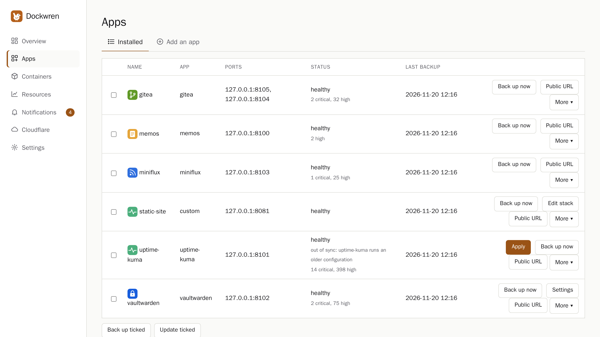
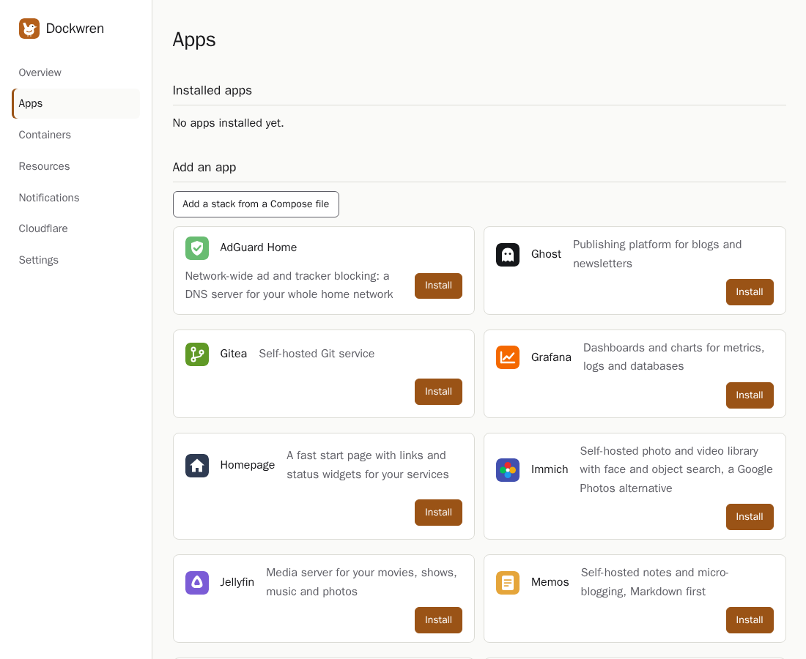
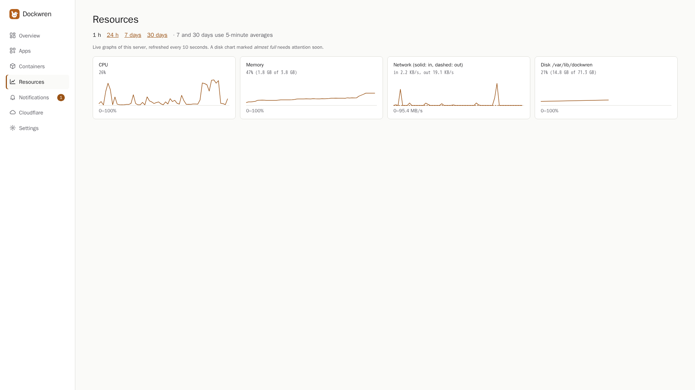
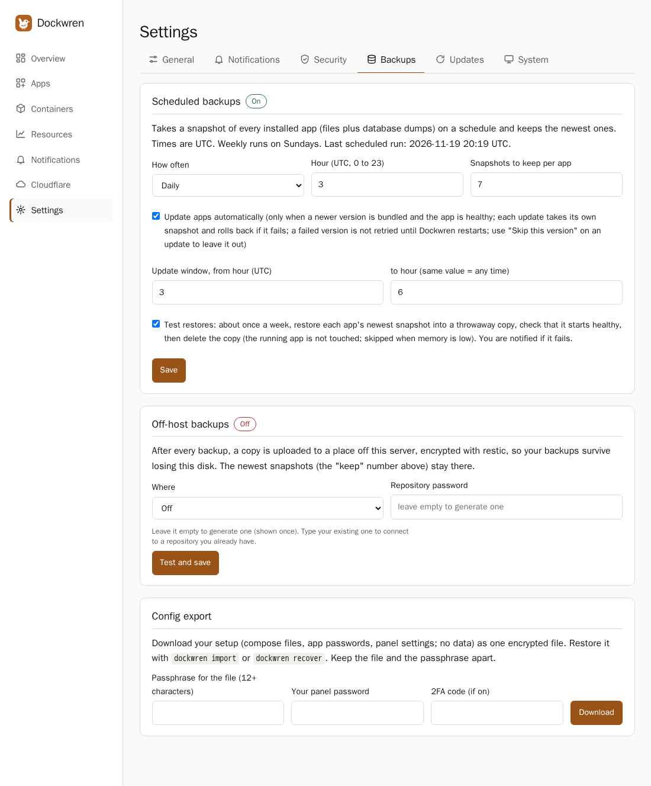
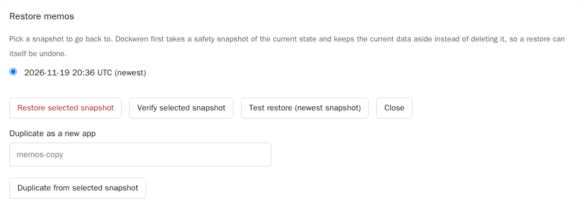
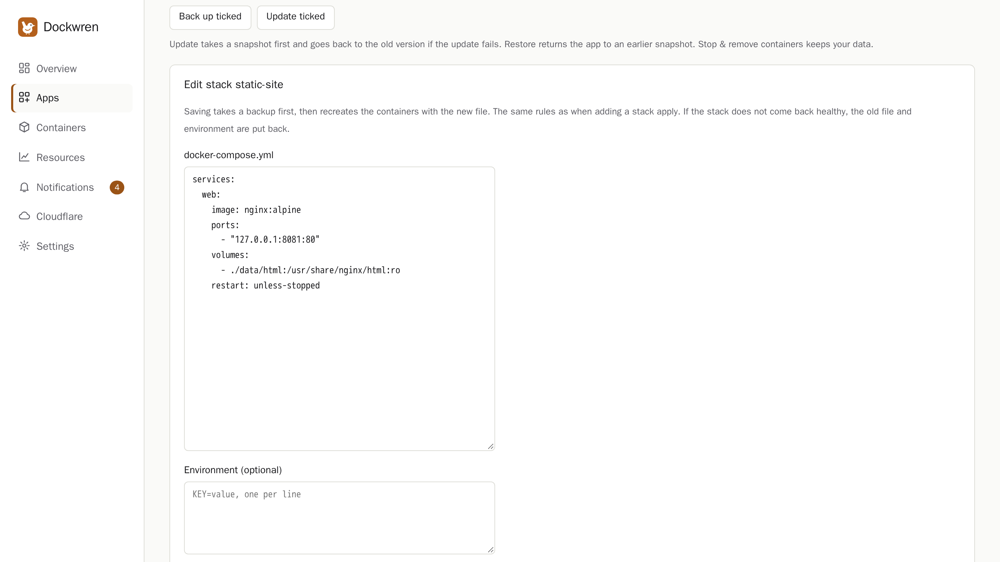
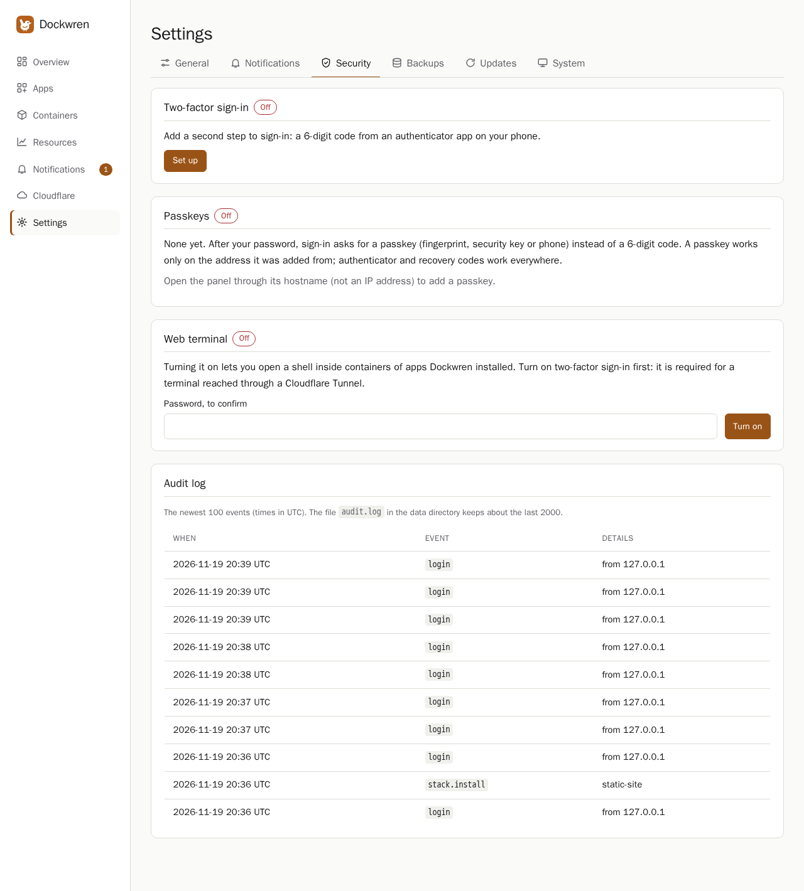
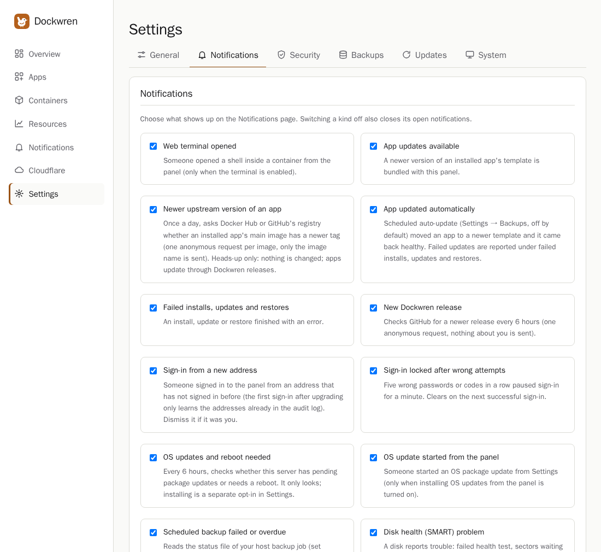

<p align="center">
  
</p>

<h1 align="center">Dockwren</h1>

<p align="center">
  <strong>A small, Docker-only control panel for your own server.</strong><br>
  Install apps from Compose templates, update them with automatic rollback, back up and restore them,<br>
  publish them over HTTPS and keep an eye on the host. One static Rust binary, no database, no agents.
</p>

<p align="center">
  <a href="https://github.com/ovexro/dockwren/releases"></a>
  <a href="LICENSE"></a>
  <a href="https://dockwren.dev">Website</a> &bull;
  <a href="docs/FEATURES.md">Features</a> &bull;
  <a href="docs/OPERATIONS.md">Operations</a> &bull;
  <a href="SECURITY.md">Security</a>
</p>

<p align="center">
  <picture>
    <source media="(prefers-color-scheme: dark)" srcset="docs/screenshots/installed-dark.png">
    
  </picture>
</p>

## Quick start

On a fresh Debian or Ubuntu server, as root (installs Docker if it is missing):

```sh
curl -fsSL https://raw.githubusercontent.com/ovexro/dockwren/main/install.sh | sudo bash
```

It downloads the latest release binary for your architecture (x86_64 or aarch64), creates a
`dockwren` system user and a systemd service, and prints the admin password **once**. The panel
listens on `127.0.0.1:8080` only; reach it with an SSH tunnel:

```sh
ssh -L 8080:127.0.0.1:8080 you@your-server
```

then open `http://localhost:8080`. Read the script before piping it to a shell; options are
described at its top (for example `--binary` to use a binary you copied yourself). Release
binaries and `SHA256SUMS` are on the [releases page](https://github.com/ovexro/dockwren/releases).

## What you get

- **Apps from templates:** Actual Budget, AdGuard Home, Audiobookshelf, Ghost, Gitea, Grafana, Homebox, Homepage, Immich, Jellyfin, Linkding, Mealie, Memos, Miniflux, n8n, Navidrome, Nextcloud, Paperless-ngx, Pi-hole, Roundcube, SnappyMail, Stirling-PDF, Syncthing, Uptime Kuma, Vaultwarden, Wiki.js, WordPress. Add your own with a manifest and a Compose file, or paste a Compose file and **edit stack** later, with **version history**. **Adopt** a Compose project that is already running, without touching it.
- **Safe updates:** a snapshot first, a preview of what changes, automatic rollback if the new version is not healthy. Drift detection shows apps that no longer match their files, with one **Apply**.
- **Backups and restore:** scheduled snapshots, **off-host** copies (SFTP or S3, encrypted), verify, weekly test restores, duplicate an app from a snapshot, and `dockwren recover` for a lost server.
- **Public addresses:** Cloudflare Tunnel, or direct HTTPS with Let's Encrypt (bundled Caddy). See [Publishing](docs/PUBLISHING.md).
- **Monitoring:** resource graphs, disk, memory and CPU alerts, UPS power-cut alerts (via NUT), crash and health alerts, image vulnerability scan, public address checks. Notifications go to the panel bell, ntfy, Telegram or a webhook.
- **Careful by design:** Argon2id login, **two-factor** and **passkey** sign-in, an audit log, an opt-in web terminal, **registry login** for private images, **schedule** stop/start, **needs** between apps, resource limits, log caps.

Every feature in detail: [docs/FEATURES.md](docs/FEATURES.md).

## Screenshots

Light and dark follow your GitHub theme. Click an image for full size.

<details open>
<summary><strong>App catalog</strong> and install forms with generated passwords</summary>

<picture>
  <source media="(prefers-color-scheme: dark)" srcset="docs/screenshots/apps-dark.png">
  
</picture>
</details>

<details>
<summary><strong>Resources</strong> — CPU, memory, network and disk graphs</summary>

<picture>
  <source media="(prefers-color-scheme: dark)" srcset="docs/screenshots/resources-dark.png">
  
</picture>
</details>

<details>
<summary><strong>Backups</strong> — schedule, off-host copies, config export</summary>

<picture>
  <source media="(prefers-color-scheme: dark)" srcset="docs/screenshots/settings-backups-dark.png">
  
</picture>
</details>

<details>
<summary><strong>Restore</strong> — verify a snapshot, test it on a copy, or duplicate it as a new app</summary>

<picture>
  <source media="(prefers-color-scheme: dark)" srcset="docs/screenshots/restore-dark.png">
  
</picture>
</details>

<details>
<summary><strong>Edit stack</strong> — checked, backed up first, rolled back if it does not come back healthy</summary>

<picture>
  <source media="(prefers-color-scheme: dark)" srcset="docs/screenshots/stack-edit-dark.png">
  
</picture>
</details>

<details>
<summary><strong>Security</strong> and <strong>Notifications</strong> settings</summary>

<picture>
  <source media="(prefers-color-scheme: dark)" srcset="docs/screenshots/settings-security-dark.png">
  
</picture>

<picture>
  <source media="(prefers-color-scheme: dark)" srcset="docs/screenshots/settings-notifications-dark.png">
  
</picture>
</details>

## Status and requirements

Early (v0.1.x): it works and is tested on Debian 13 and Ubuntu 24.04 (x86_64) and on a Raspberry Pi 5
(aarch64), but expect rough edges. Needs Linux with Docker running. To build from source (Rust stable):
`cargo build --release`, then `DOCKWREN_DATA=./data ./target/release/dockwren`.

## Documentation

| | |
| --- | --- |
| [Features](docs/FEATURES.md) | everything Dockwren does, in detail |
| [Operations](docs/OPERATIONS.md) | configuration (`DOCKWREN_*` variables), password, systemd service, per-app notes, security notes |
| [Publishing](docs/PUBLISHING.md) | direct HTTPS with Let's Encrypt, Cloudflare Tunnel |
| [Stacks](docs/STACKS.md) | the Compose allow-list for pasted and adopted stacks |
| [Templates](docs/TEMPLATES.md) | write your own app template |
| [Notifications](docs/NOTIFICATIONS.md) | what raises one, and ntfy, Telegram and webhook forwarding |

CLI: `dockwren [serve | set-password | disable-2fa | status-token [--revoke] | setup-osupdate | setup-smart | self-update | install | export | import | recover | backup [pull] | update | restore | verify | restore-test | scan | doctor | template add/list/remove | cleanup | expose | unexpose | remove]`.

## Support

Dockwren is free and open source. If it saves you time, you can support its development via
[PayPal](https://www.paypal.com/paypalme/ovexro).

## License

Apache-2.0, see [LICENSE](LICENSE). Security reports: see [SECURITY.md](SECURITY.md).
